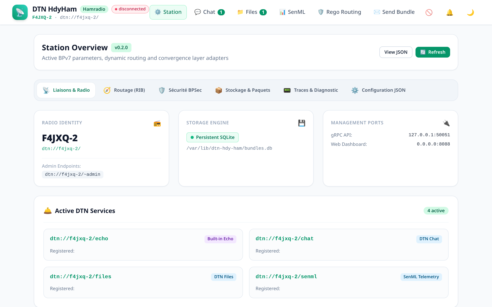
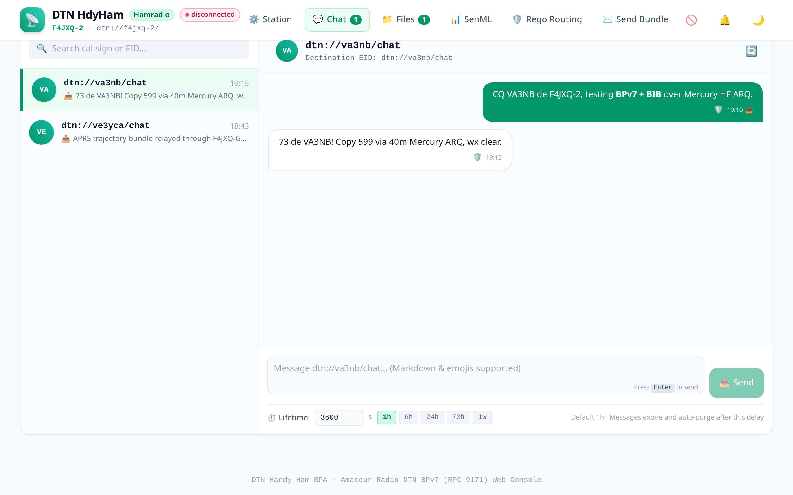
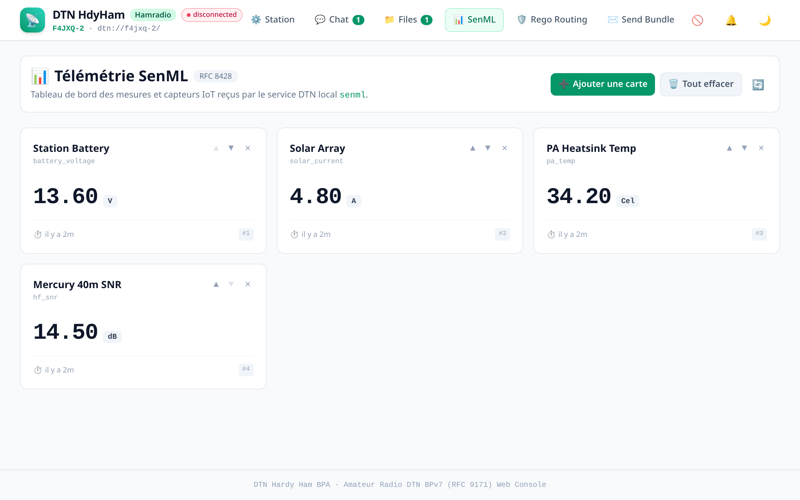
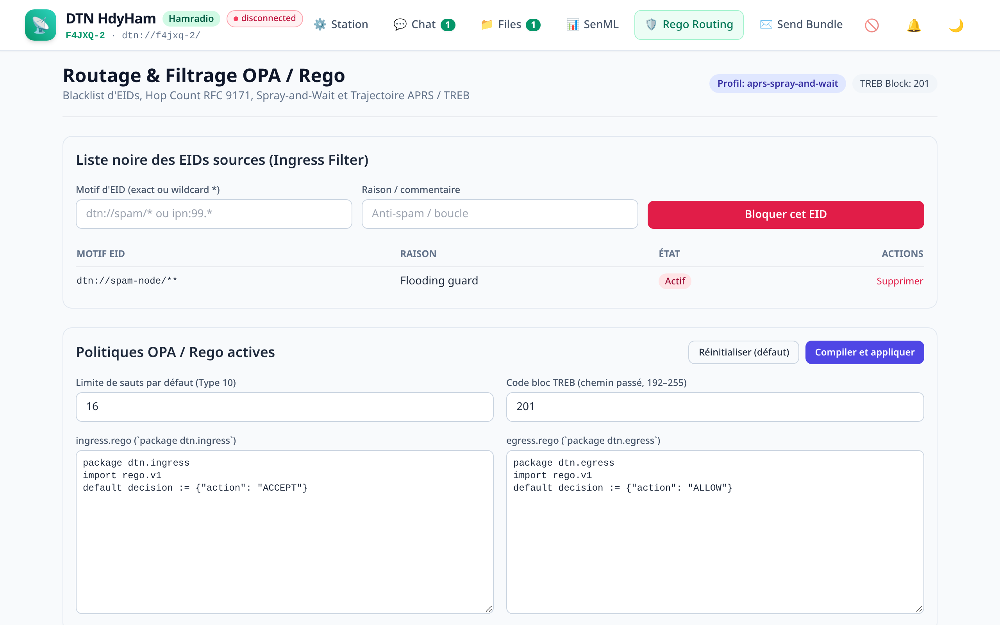

# DTN-Postmaster

**DTN Postmaster** is a software dedicated for **Hamradio Delay/Disruption-Tolerant Networking (DTN)**.

It is modular, security-hardened DTN ecosystem implementing **BPv7 (RFC 9171)** and **BPSec (RFC 9172)** (signature only) for amateur radio, remote ground station, emergency communications (EmComm), and disconnected/intermittent links — built in Rust on top of [Hardy BPA](https://github.com/ricktaylor/hardy).

---

## Web Console Highlights

| Station Overview | Interactive Chat |
| :---: | :---: |
|  |  |

| SenML Telemetry (RFC 8428) | OPA / Rego Routing & Filtering |
| :---: | :---: |
|  |  |

---

## Ecosystem Repositories

### Core & Assembly
| Repository | Description |
| --- | --- |
| [`dtnpm`](https://github.com/DTN-Postmaster/dtnpm) | Main Software (`dtnpm`), CLI utilities (`dtnsend`, `dtnprint`, `dtnping`, `dtnquery`, `dtnbib`, `dtnfiles`, …), and deployment profiles |
| [`dtnpm-core`](https://github.com/DTN-Postmaster/dtnpm-core) | Shared configuration, SQLite storage, contact coordinator, leaky-bucket pacing, BPSec keystore, and `BpaClient` |
| [`dtnpm-web-core`](https://github.com/DTN-Postmaster/dtnpm-web-core) | Axum WebUI server, `WebModule` plugin trait, RBAC/PBAC, and Preact PWA shell |

### Convergence Layer Adapters (CLAs)
| Repository | Description |
| --- | --- |
| [`dtnpm-cla-ltp-kiss`](https://github.com/DTN-Postmaster/dtnpm-cla-ltp-kiss) | Licklider Transmission Protocol (LTP, RFC 5326 / RFC 7122) engine & UDP/KISS CLA |
| [`dtnpm-cla-hqfbp-kiss`](https://github.com/DTN-Postmaster/dtnpm-cla-hqfbp-kiss) | HQFBP with FEC over KISS TCP / Serial / UDP CLA |
| [`dtnpm-cla-mercury-arq`](https://github.com/DTN-Postmaster/dtnpm-cla-mercury-arq) | Mercury HF Connected ARQ CLA |

### Web-based Applications or Modules
| Repository | Description |
| --- | --- |
| [`dtnpm-mod-rego-routing`](https://github.com/DTN-Postmaster/dtnpm-mod-rego-routing) | Declarative OPA/Rego (`regorus`) filtering & per-bundle `RegoRib` routing (APRS trajectories, TREB, Spray-and-Wait, Hop Count Type 10) |
| [`dtnpm-mod-chat`](https://github.com/DTN-Postmaster/dtnpm-mod-chat) | Fullstack DTN Chat module (`/api/chat/v1/...`) |
| [`dtnpm-mod-files`](https://github.com/DTN-Postmaster/dtnpm-mod-files) | Fullstack DTN File Transfer module (`/api/files/v1/...`) |
| [`dtnpm-mod-senml`](https://github.com/DTN-Postmaster/dtnpm-mod-senml) | Fullstack DTN SenML (RFC 8428) telemetry gateway & dashboard (`/api/senml/v1/...`) |

### Standalone Applications
| Repository | Description |
| --- | --- |
| [`dtnpm-app-basket`](https://github.com/DTN-Postmaster/dtnpm-app-basket) | Files sharing, Gemini/Web-over-DTN basket DTN service (`dtnbasket`, `dtnbasket-cli`) |

### Templates & Agent Skills
| Repository | Description |
| --- | --- |
| [`template-dtnpm-app`](https://github.com/DTN-Postmaster/template-dtnpm-app) | Starter template for standalone DTN applications |
| [`template-dtnpm-cla`](https://github.com/DTN-Postmaster/template-dtnpm-cla) | Starter template for Convergence Layer Adapters |
| [`template-dtnpm-mod`](https://github.com/DTN-Postmaster/template-dtnpm-mod) | Starter template for fullstack `WebModule` plugins |
| [`dtnpm-skills`](https://github.com/DTN-Postmaster/dtnpm-skills) | Operator skills for station setup, RF/CLA tuning, IAM/BPSec, and diagnostics |
| [`dtnpm-skills-dev`](https://github.com/DTN-Postmaster/dtnpm-skills-dev) | Developer skills for scaffolding apps/CLAs/modules, CRA security audits, and fuzzing |

---

## Deployment Profiles (`dtnpm`)

- **`desktop`** *(default)*: Full all-in-one station (`node`, WebUI, LTP/HQFBP/Mercury CLAs, Chat/Files/SenML/Rego modules)
- **`node-headless`**: Headless RF/TCPCL router node with gRPC control plane
- **`webui-remote`**: Remote operator console connecting to a BPA over gRPC

---

## Engineering & Security Standards

- **Protocols**: BPv7 (RFC 9171), BPSec (RFC 9172) with strict verification by default, LTP (RFC 5326 / RFC 7122), SenML (RFC 8428)
- **Safety & Quality**: Zero-`unwrap()` / zero-`panic!()` policy in production Rust targets (`-D clippy::unwrap_used -D clippy::panic`)
- **Supply Chain & CRA**: Automated `cargo fmt`, `clippy`, `gitleaks`, `cargo-audit`, `cargo-deny`, and CycloneDX SBOM generation in CI
- **License**: Dual-licensed under Apache-2.0 or MIT
